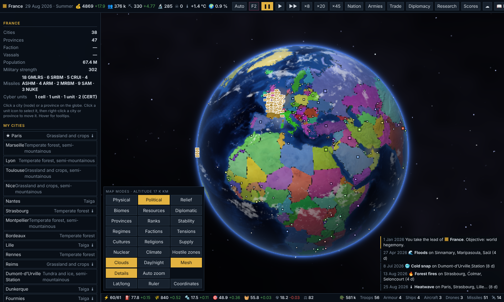
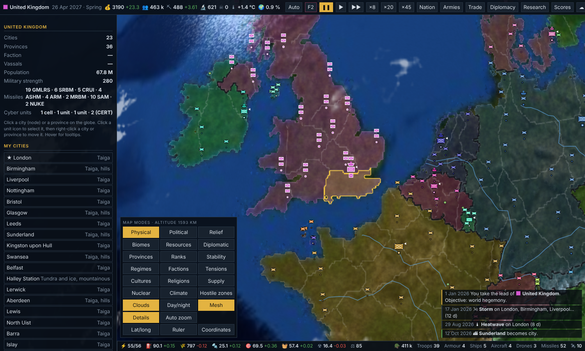

# Hegemony — from Earth to the stars

A grand strategy game on a 3D WebGL globe, inspired by *Rise of Nations*. Lead one of 238 nations in today's world, expand until hegemony, then take your civilisation to the Moon, the solar system and 50 star systems.

The whole game is **a single self-contained HTML file** (≈6.4 MB: code, map data and Earth textures). No install, no server, no external dependency, and it plays offline.

**▶ Play:** open [`index.html`](index.html) in Chrome, Edge or Firefox. Once GitHub Pages is enabled, it is also playable at `https://<your-user>.github.io/hegemony/`.
A French edition is included: [`hegemonie_fr.html`](hegemonie_fr.html).




## Features

- **The real world, in 2026.** 238 nations, 2,185 cities and 2,963 provinces fitted to real borders, with biomes from satellite imagery, real relief, rivers, sea lanes and resources (oil, gas, ores, cereals, rare earths, uranium…).
- **Economy and society.** Treasury, materials, energy, fuel, food, components, goods and ammunition; 24 infrastructures, taxation, mobilisation, debt, regimes, stability, migrations, cultures and religions.
- **Warfare.** 27 land, naval, air, drone and strategic units, 10 missile types, cyber warfare, satellites, supply lines, zones of control, morale, generals, sieges, naval mines, paratroopers and amphibious landings.
- **Power that feels real.** National technology (1–4) and military experience (1–3.5) levels; starting military power calibrated (US 30%, China 18%, Russia 10%, India 10%, EU 8%); currencies with a dollar advantage; a power index that drives strategy.
- **Diplomacy.** Justified wars, factions, alliances, vassals, peace treaties with clauses, ceasefires, coups, formable nations, a nuclear doctrine based on ultimatums, and anti-hegemony coalitions when a power grows too big.
- **The world pushes back.** Overextension crises in newly conquered cities, supply troubles for huge empires, hostile zones (Siberia, Sahara, Amazon…) with refuge capitals, islands and mountains that are hard to invade, strategic locks around the great powers' largest cities, and frozen polar seas that need icebreakers.
- **Climate change.** 20 regional effects rising until 2100, plus weather and seasons.
- **A believable calendar.** Each turn is 4 days, so a full-scale invasion takes years, not weeks.
- **Close-up view.** Below 800 km altitude, procedurally drawn cities, units, battles, strikes and missiles.
- **Space endgame.** After winning on Earth: colonies, fleets, research and alien civilisations across 50 star systems.
- **Tools.** 18 map modes, lat/long grid, multipoint ruler (distances and areas), an in-game encyclopedia, a spectator mode, a cheat console (F2) and automatic saves to a folder of your choice (Chrome/Edge).

## Controls

Drag to rotate, wheel to zoom, click to select, right-click to give a move order. Space pauses, 1–5 set the speed, M cycles map modes, H opens the help, F2 opens the cheat console. The full manual is in the in-game encyclopedia (📖 Help).

## Building from source

Requirements: Node.js 18+ and, for the tests, Chrome or Chromium.

```bash
npm install
npm run build       # → hegemonie_fr.html (French) and index.html (English)
npm test            # headless browser tests (set CHROME_PATH if Chrome is not at /usr/bin/google-chrome)
npm run test:world  # 700-turn "Great powers" world simulation
```

### Project layout

| Path | Content |
|---|---|
| `src/` | The game, in 19 modules concatenated in the order set in `build.js`. The source UI language is French. |
| `src/index.html` | Page skeleton and home screen |
| `i18n/` | English edition: string extraction (`extract.js`), dictionaries (`t1–t9.py`, `th.py`, `tx.json`), English country and city names, and `build_en.js`, which rewrites the sources into `i18n/out/` |
| `data/` | Map data (`gamedata.json`, `tiles.bin.gz`) and Earth textures |
| `tools/map/` | Scripts that generated the map data (for reference; the raw inputs are not included) |
| `tests/` | Puppeteer test suites (≈200 checks) |

### Adding or changing text

Write UI text in French in `src/`, then run `node i18n/extract.js` to list new strings and add their English translation to `i18n/tx.json` (key = exact French text). `npm run build` regenerates both editions; `tests/entest.js` reports any French left in the English build.

## Credits

- Earth imagery: NASA Blue Marble / Visible Earth (public domain).
- Cities: GeoNames data via the `all-the-cities` package (GeoNames data is licensed CC BY 4.0).
- Country borders and figures: Natural Earth via `world-atlas`, and `world-countries`.
- Inspired by *Rise of Nations*.

## License

No license has been chosen yet: all rights reserved until one is added.
